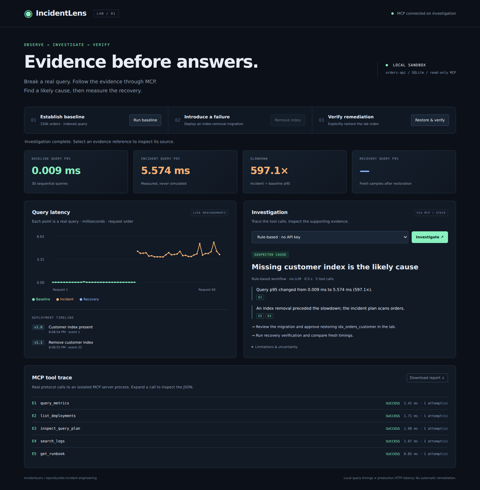
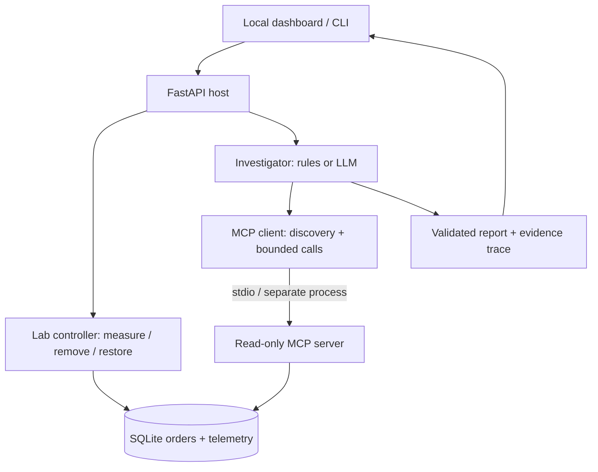

# IncidentLens

**Evidence before answers.** A reproducible incident investigation lab powered by the Model Context Protocol (MCP).

Remove a real database index. Measure the regression. Investigate through an isolated MCP server. Restore the index yourself and verify recovery.



## Why this exists

An incident summary is only useful if you can inspect the evidence behind it. IncidentLens makes the entire chain visible: actual query measurements, deployment events, historical query plans, MCP calls, and cited findings.

It is a **local engineering lab**, not a production autonomous SRE. The sample service is a Python query workload over SQLite; it does not contain a Spring Boot service or a deployed observability stack.

## Run in two commands

Requires Python 3.11+ and [uv](https://docs.astral.sh/uv/getting-started/installation/).

```bash
uv sync --frozen --extra dev
uv run incidentlens serve
```

Open **http://127.0.0.1:8000**.

1. **Run baseline** — seed 150,000 orders and record 30 indexed-query timings.
2. **Remove index** — apply a real `DROP INDEX` migration and record 30 new timings.
3. **Investigate** — read evidence through MCP and inspect the linked tool trace.
4. **Restore & verify** — explicitly restore the index; record fresh samples.
5. **Investigate again** — inspect whether the measurements support recovery.

No API key is required for the rule-based mode. To try the insufficient-evidence path, investigate immediately after a baseline.

### Without uv

```bash
python -m venv .venv
# macOS / Linux
source .venv/bin/activate
# Windows PowerShell: .venv\Scripts\Activate.ps1
python -m pip install -e '.[dev]'
incidentlens serve
```

### Headless demo

```bash
uv run incidentlens demo > report.json
```

The JSON includes the report, supporting evidence, tool arguments, durations, and retry counts. Runtime data and reports are not committed.

## Two honest investigation modes

| Mode | Who chooses tools? | Who writes the conclusion? | API key |
|---|---|---|---|
| Rule-based | Fixed five-tool workflow | Conservative, lab-specific heuristics | No |
| LLM agent | Model, using discovered MCP schemas | Model, validated against a report schema and evidence IDs | Yes |

Both modes use the **official MCP Python SDK** and actual stdio client/server communication. Neither investigator reads the database directly. MCP exposes capabilities; the host application owns orchestration and reasoning.

### Optional LLM agent

Set variables in the shell that launches the server. `.env.example` is a reference; this application does **not** automatically load `.env` files.

```bash
export OPENAI_API_KEY="your-key"
export OPENAI_MODEL="gpt-4.1-mini"
uv run incidentlens serve
```

PowerShell: `$env:OPENAI_API_KEY="your-key"` and `$env:OPENAI_MODEL="gpt-4.1-mini"`.

Choose **LLM agent** in the dashboard, or run `uv run incidentlens demo --mode llm`. The key remains on the server. This mode sends lab telemetry to OpenAI and incurs API usage. Tool selection is bounded to 8 rounds / 10 calls, with a 180-second API deadline. Provider failures produce an error, never a silent rule-based fallback.

Evidence-ID validation verifies that cited tool results exist; it **does not prove that an LLM's interpretation is correct**. LLM mode requires human review. Its provider interaction is tested with mocks; live provider verification requires your own key.

## Architecture



The shared lab serializes mutations and investigations with a single operation gate. SQLite uses WAL. Each baseline creates a new experiment ID; requests targeting stale experiments are rejected. Deployments and query-plan snapshots are persisted so restoration cannot rewrite incident history.

### MCP capabilities

| Capability | Purpose |
|---|---|
| `query_metrics(experiment_id)` | Timings, sample counts, phase p95 and event boundaries |
| `list_deployments(experiment_id)` | Deployment timeline and migration SQL |
| `inspect_query_plan(experiment_id)` | Historical incident/recovery `EXPLAIN QUERY PLAN` snapshots |
| `search_logs(experiment_id, limit)` | Bounded request telemetry; maximum 50 rows |
| `get_runbook()` | Investigation steps and limitations |
| Resource `runbook://orders-api` | Runbook accessible through MCP resources |

There is no MCP tool for running arbitrary SQL, reading arbitrary files, or applying remediation. The controller and MCP server have separate responsibilities. DB reads in the MCP server use SQLite read-only connections.

### Connect an external MCP host

Start the dashboard and run a baseline first. Configure your MCP host with absolute paths:

```json
{
  "mcpServers": {
    "incidentlens": {
      "command": "/absolute/path/incidentlens/.venv/bin/python",
      "args": ["-m", "incidentlens.mcp_server"],
      "env": {"INCIDENTLENS_DB": "/absolute/path/incidentlens/data/lab.db"}
    }
  }
}
```

On Windows, use `.venv\\Scripts\\python.exe`. Copy the current experiment ID from `/api/state`, then ask your host to investigate that experiment. MCP host configuration formats may vary. The project pins SDK v1 (`mcp==1.30.0`); it does not claim support for every future protocol version or host.

## Engineering decisions

- **Evidence before conclusions:** missing measurements, weak slowdown signals, or absent corroboration produce `insufficient_evidence` in rules mode.
- **Causal restraint:** the rule-based hypothesis requires at least a 3× p95 change, an index-removal event between the baseline and incident samples, and a recorded table scan.
- **Recovery verification:** fresh recovery p95 must improve by at least 3×, and a recorded restoration must precede recovery samples.
- **Bounded failure:** read-only tool calls have an 8-second timeout and one retry on timeout/disconnection, with partial evidence retained. MCP validation errors are not retried.
- **Controlled mutation:** only explicit dashboard/CLI lab operations change the index. The LLM cannot remediate through MCP.
- **Observable execution:** downloadable JSON contains every completed tool call, arguments, retrieved data, timings, and attempt counts.
- **Local isolation:** the CLI binds localhost; Host/Origin checks reject cross-origin browser access. No remote authentication is implemented.

## Tests and CI

```bash
uv run pytest -q
uv run ruff check .
uv run ruff format --check .
```

Tests cover real index removal/restoration, historical evidence, read-only DB access, MCP discovery/tools/resources over an actual subprocess, partial tool failures, timeout bounds, invented citations, mocked LLM tool routing, stale experiments, and the HTTP lifecycle. CI runs on Python 3.11 and 3.12. Timing speedups are intentionally not asserted on noisy CI hardware.

The `/metrics` endpoint exposes measured phase p95 values in Prometheus text format. Prometheus and Grafana are **not** bundled.

## Scope and limitations

- Query execution latency, not end-to-end HTTP latency. No artificial sleep-based slowdown.
- Thirty sequential local queries per phase are a demo, not a statistically rigorous load test.
- One shared SQLite lab, one server worker, no multi-tenant or production deployment support.
- Logs are the lab's recorded request telemetry, not an external log aggregation service.
- The model can misinterpret evidence; schemas and citations reduce some errors, not all.
- The host forwards the DB path and the SDK supplies a minimal OS environment; provider credentials are not forwarded. Read-only tools are a capability boundary, not an OS sandbox. Only run trusted server code.
- No advertised production MTTR improvement, accuracy percentage, or universal performance multiplier.

Next extensions: PostgreSQL adapter, real Prometheus/Loki backends, independent incident fixtures, semantic report evaluations, and per-tenant authorization for a remote MCP server.

See [architecture notes](docs/architecture.md), the [90-second demo guide](docs/demo-guide.md), and a [measured example report](docs/example-report.json). The example timings describe one local run only.

## References

- [MCP architecture](https://modelcontextprotocol.io/docs/learn/architecture)
- [Official MCP Python SDK v1](https://py.sdk.modelcontextprotocol.io/v1/)
- [SQLite EXPLAIN QUERY PLAN](https://www.sqlite.org/eqp.html)

## License

MIT. See [LICENSE](LICENSE).
